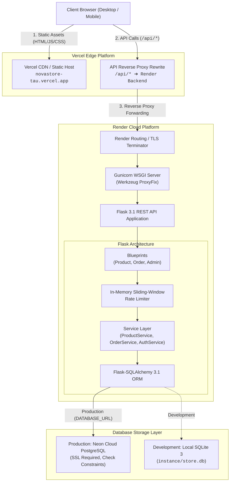

# NovaStore — Architecture Documentation

This document describes the end-to-end system architecture of NovaStore, detailing the frontend, backend, database layers, hosting topology, security boundaries, and data flow.

---

## 1. System Topology Overview

NovaStore operates as a decoupled, multi-tier web application. The single-page frontend (SPA) is hosted on Vercel, the REST API backend runs on Render, and relational persistence is provided by Neon PostgreSQL in production (and SQLite in local development).



---

## 2. Component Details

### A. Frontend Layer (React 19 + Vite 6)
- **Framework & Tooling:** React 19.x with Vite 6.x as the development server and production bundler.
- **Language & Paradigms:** Modern ECMAScript (ES Modules) utilizing React functional components and hooks (`useState`, `useEffect`, `useContext`, `useRef`).
- **State Management:**
  - `CartContext`: Centralized shopping cart state managing item additions, quantity steppers, boundary stock limits, financial recalculation, and cross-session persistence via browser `localStorage` (`novastore_cart_items`).
  - `AdminAuthContext`: Administrator authentication state, active tab management, session bootstrapping, and response interception.
- **Design System:** Vanilla CSS (`style.css`) built upon semantic CSS custom properties (design tokens) for dark/light contrast, responsive grid layouts, and accessible UI feedback. No heavyweight CSS utility dependencies.
- **Routing:** Single-page application view routing controlled by `CartContext` (`currentView`: `"catalog" | "cart" | "checkout" | "confirmation" | "admin"`), maintaining clean user state without full-page refreshes.

### B. Hosting & Edge Routing
- **Frontend Hosting (Vercel):** Serves compiled static assets (`dist/`) globally via edge CDN with HTTPS.
- **API Rewrite Proxy (`vercel.json`):**
  ```json
  {
    "rewrites": [
      { "source": "/api/(.*)", "destination": "https://novastore-api-2w65.onrender.com/api/$1" },
      { "source": "/(.*)", "destination": "/index.html" }
    ]
  }
  ```
  This configuration enables the SPA to make same-origin API calls to `/api/*`, avoiding browser cross-origin cookie restrictions and ensuring seamless `HttpOnly` cookie transmission.
- **Backend Hosting (Render):** Managed Linux container running Gunicorn and Python 3.13.

### C. Backend API Layer (Flask 3.1)
- **Application Factory Pattern:** `create_app()` initializes configurations dynamically based on `FLASK_ENV` (`development`, `testing`, `production`).
- **Blueprints:**
  - `product_bp` (`/api`): Public product discovery, category summaries, and single-item specification routes.
  - `order_bp` (`/api`): Order submission and public order reference lookup.
  - `admin_bp` (`/api/admin`): Guarded admin authentication, KPI executive overview, inventory CRUD, and fulfillment lifecycle tracking.
- **Service Layer Architecture:**
  - `ProductService`: Query building, category aggregation, and price range boundary enforcement.
  - `OrderService`: Zero-trust financial calculation, stock reservation, and atomic transaction execution.
  - `AuthService`: Password hash verification, cryptographic session token generation, and token revocation.
  - `AdminService`: Dashboard KPI metrics calculation and administrative state machine updates.
- **Reverse Proxy Support:** Werkzeug `ProxyFix` middleware is conditionally enabled when `TRUSTED_PROXIES_COUNT > 0` to accurately evaluate client IP addresses behind load balancers.

### D. Relational Database Layer
- **ORM:** Flask-SQLAlchemy 3.1 (wrapping SQLAlchemy 2.0.x core).
- **Development Database:** Local SQLite 3 (`backend/instance/store.db`) with foreign key enforcement enabled via SQLite `PRAGMA foreign_keys=ON`.
- **Production Database:** Neon Cloud PostgreSQL running in high-availability cloud infrastructure with strict SSL requirements (`sslmode=require`).
- **Data Models:**
  - `Product`: Item specifications, INR pricing, stock quantity, active status, category, and timestamps.
  - `Order`: Customer delivery details, delivery fee, order status, total amount, ISO currency code, and unique reference.
  - `OrderItem`: Purchase-time immutable price snapshots, item quantity, line total, and relational product linkages.
  - `Admin`: Username, email, cryptographic password hash (`scrypt/pbkdf2`), active state, and password update tracking.
  - `RevokedToken`: Historical revocation log for invalidated session tokens.

---

## 3. Data Flow & Request Lifecycles

### A. Storefront Product Browsing
1. The client browser loads static assets from Vercel.
2. The client fetches product catalogue data via `GET /api/products` and category aggregates via `GET /api/categories`.
3. Vercel's rewrite proxy transparently forwards the request to the Render backend.
4. Flask queries PostgreSQL/SQLite via SQLAlchemy, serializes the product records to JSON, and responds through the proxy chain to the client.

### B. Shopping Cart & Checkout Flow
1. **Local Selection:** Products are added to `CartContext`. Quantity changes are validated against live warehouse stock before mutating local state. Cart contents are serialized to `localStorage`.
2. **Order Submission:** When the customer submits checkout, the frontend posts customer details and item ID/quantity pairs to `POST /api/orders`.
3. **Zero-Trust Backend Calculation:**
   - The backend completely ignores client-submitted prices, subtotals, and delivery charges.
   - For every submitted item, the authoritative price and stock level are fetched directly from the database.
   - Delivery fee is calculated on the server: flat ₹99.00 fee for orders $< ₹999.00$; Free Delivery (₹0.00) for orders $\ge ₹999.00$.
4. **Atomic Transaction:**
   - Product stock is verified and decremented.
   - Database check constraint `check_product_stock_non_negative` ensures stock never drops below zero.
   - `Order` and `OrderItem` records are created within a single database transaction.
   - If any validation or inventory constraint fails, `db.session.rollback()` is executed, leaving inventory untouched.
5. **Confirmation:** Upon HTTP 201 Created, the frontend clears `localStorage` and presents the order confirmation view with the generated reference code (`ORD-YYYYMMDD-XXXXXXXX`).

---

## 4. Administrative Security Architecture

### A. Authentication & Session Cookies
- Administrators authenticate via `POST /api/admin/login`.
- Upon successful credential verification, Flask issues a signed, timestamped session token generated with `itsdangerous.URLSafeTimedSerializer`.
- The token is set in an `admin_session` cookie configured with:
  - `HttpOnly = True` (inaccessible to JavaScript, defending against XSS exfiltration).
  - `SameSite = "Strict"` (restricts cross-site request transmission).
  - `Secure = True` (enforced in production across HTTPS connections).
  - `Max-Age = 7200` (expires after 2 hours).

### B. Synchronizer CSRF Protection
- Alongside the `admin_session` cookie, the login response issues a synchronizer CSRF token in an un-httponly `csrf_token` cookie and JSON body.
- For all state-mutating requests (`POST`, `PUT`, `PATCH`, `DELETE`), the frontend JavaScript extracts the CSRF token and passes it in the `X-CSRF-Token` HTTP header.
- The backend validates that the `X-CSRF-Token` header matches the cryptographically signed session before executing mutations.

### C. Rate Limiting
- A thread-safe, in-memory sliding window rate limiter guards sensitive routes:
  - `POST /api/admin/login`: Defaults to 5 attempts per 60 seconds per IP.
  - `POST /api/orders`: Defaults to 10 submissions per 60 seconds per IP.
- Rate-limited requests receive `HTTP 429 Too Many Requests` with a `Retry-After` header.

---

## 5. Architectural Boundaries & Cross-References

For additional technical details regarding specific domains of NovaStore, refer to:
- **[DEPLOYMENT.md](./DEPLOYMENT.md)**: Cloud hosting setup, environment variables, build commands, and smoke test procedures.
- **[DATABASE_MIGRATION.md](./DATABASE_MIGRATION.md)**: SQLite-to-PostgreSQL migration procedure, safeguards, and sequence synchronization.
- **[SECURITY.md](./SECURITY.md)**: Security implementation details, cryptographic standards, and documented architectural boundaries.
